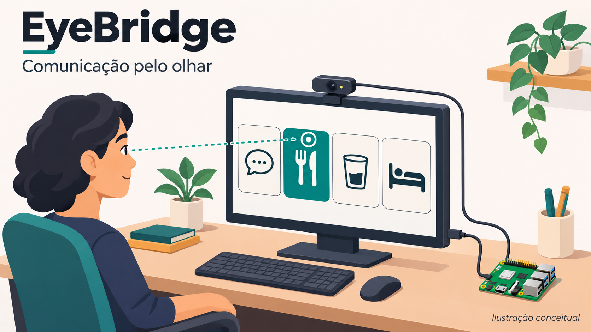
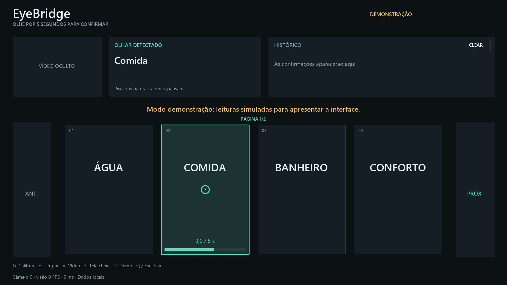
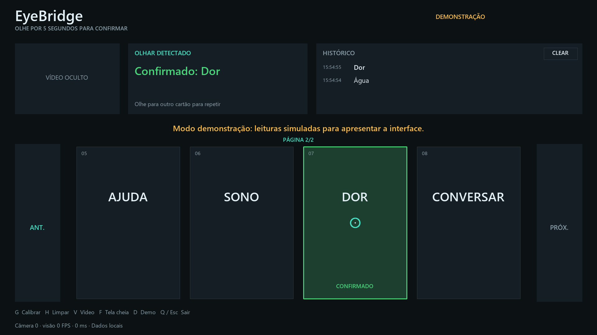
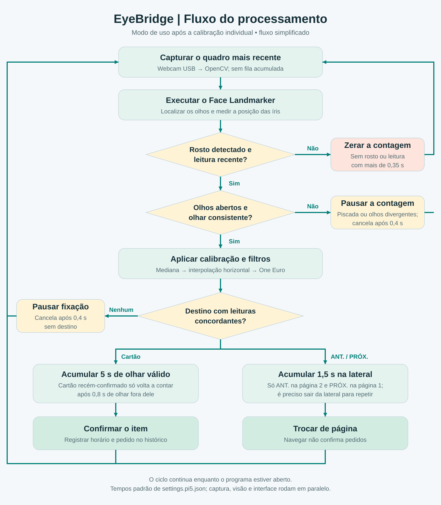

# EyeBridge

Protótipo de comunicação por olhar, com webcam USB e processamento local.
Compatível com Windows e Raspberry Pi 5 / Debian de 64 bits.




*Ilustração conceitual gerada por IA; a tela desenhada não é uma captura do aplicativo.*

## A ideia do projeto

O EyeBridge nasceu como um projeto acadêmico de tecnologia assistiva para explorar
uma forma de comunicação baseada no movimento dos olhos. A proposta é permitir
que pessoas com limitações motoras e controle ocular suficiente indiquem necessidades
básicas por meio de cartões visuais, usando uma webcam USB comum.

O objetivo do protótipo é transformar o olhar em uma escolha visível na tela, com
calibração individual e confirmação por tempo de permanência. A escolha confirmada
fica registrada no histórico para consulta por quem acompanha o usuário.

## O que o usuário pode fazer

- Página 1: Água, Comida, Banheiro e Conforto.
- Página 2: Ajuda, Sono, Dor e Conversar.

A mira acompanha o olhar na horizontal. Fixar um cartão por **5 segundos** confirma
um pedido e registra o horário. Olhar para **ANT.** ou **PRÓX.** por **1,5 segundo**
troca a página. Piscadas pausam a contagem.

## Instalação

Clone ou baixe o repositório. Mantenha `models/face_landmarker.task` nessa pasta.
O instalador precisa de internet; depois o reconhecimento usa o modelo local.

### Windows

Use Python 3.11 ou 3.12 de 64 bits e execute na pasta do projeto:

```powershell
powershell -ExecutionPolicy Bypass -File .\instalar_windows.ps1
.\iniciar_windows.cmd
```

### Raspberry Pi 5

Use sistema de 64 bits, sessão gráfica e webcam USB:

```bash
bash instalar_linux.sh
bash iniciar_linux.sh --backend opencv --camera 0 --config settings.pi5.json
```

Não copie `.venv` entre computadores. Execute o instalador no destino.
O [guia de instalação](INSTALAR_E_USAR_RASPBERRY.txt) inclui diagnóstico da câmera.

## Calibração e controles

Pressione **G** e acompanhe os alvos. São seis posições horizontais em duas passagens,
cerca de 33 segundos sem interrupções. Refaça ao mudar pessoa, câmera ou posição.
O perfil pessoal fica em `calibration-normal.json` e é ignorado pelo Git.

| Controle | Função |
| --- | --- |
| G ou C | Calibrar |
| H / CLEAR | Limpar histórico |
| V | Alternar miniatura |
| F | Alternar tela cheia |
| M | Espelhar a miniatura |
| D | Alternar demonstração |
| Q / Esc | Sair |

Na demonstração, use o mouse ou 1 a 4. As laterais trocam a página.
Para repetir um pedido, olhe para fora do cartão por 0,8 segundo e volte.

## Demonstração visual

As imagens abaixo foram renderizadas pelo próprio código da interface com
leituras de olhar simuladas. Mostram a interface real em modo demonstração;
não são fotografias de uso por uma pessoa nem medições de desempenho na Raspberry.

### Seleção por tempo de olhar



A mira acompanha a direção horizontal; a barra mostra o tempo válido de fixação.

### Confirmação e histórico



A segunda página apresenta os demais itens. Os registros mostrados são da simulação.

## Arquitetura

O programa organiza o trabalho em três partes executadas separadamente:

```text
Webcam USB
    |
    v
Captura: mantém o quadro mais recente
    |
    v
Visão e interação: olhos -> calibração -> filtros -> tempo de confirmação
    |
    v
Interface: mira, cartões e histórico
```

A captura não acumula uma fila de imagens para analisar depois. Isso reduz o atraso
entre o olhar atual e a resposta visual. A interface usa uma cópia do estado da
sessão, evitando que o desenho bloqueie diretamente a análise da câmera.

## Fluxograma do funcionamento



O diagrama representa o modo de uso após a calibração individual. As contagens
avançam apenas com leituras válidas que sustentam o destino; os dois ramos não
representam confirmações imediatas. O ciclo continua enquanto o programa está aberto.

Também disponível em [PNG](documentacao/imagens/fluxograma.png) e como
[fonte Mermaid editável](documentacao/imagens/fluxograma.mmd).

## Como o olhar vira uma escolha

O Face Landmarker estima 478 marcos faciais. A geometria ocular lê diretamente
14 pontos: seis pontos de contorno e um centro de íris em cada olho. A posição da
íris é normalizada pela largura do olho, combinada entre os dois olhos e relacionada
às posições da interface por calibração e interpolação horizontal.

A mediana reduz leituras isoladas fora do padrão. O filtro One Euro suaviza pequenas
oscilações e responde mais rapidamente a movimentos maiores. A configuração atual
usa somente a direção horizontal para escolher os cartões, em duas páginas.

O modelo de aprendizado de máquina já vem treinado. A calibração individual ajusta
a relação entre olhos e tela; ela não treina novamente a rede neural.

## Tecnologias

| Tecnologia | Tipo | Papel no projeto |
| --- | --- | --- |
| Python | Linguagem | Implementação do aplicativo |
| OpenCV | Biblioteca de visão | Captura da câmera e apresentação da janela |
| NumPy | Biblioteca numérica | Geometria ocular, medianas e interpolação |
| Pillow | Biblioteca de imagem | Preparação dos textos da interface |
| MediaPipe | Framework de aprendizado de máquina | Execução do modelo facial |
| Tasks / Face Landmarker | API / tarefa de visão | Acesso aos marcos faciais e sinais das pálpebras |
| V4L2 | API de vídeo do Linux | Acesso à webcam na Raspberry Pi |
| DirectShow | API multimídia | Acesso à webcam no Windows |

## Processamento e desempenho

### Tempos observados

Resultados aproximados informados pela equipe durante os testes do protótipo:

| Plataforma | Tempo reportado nos testes |
| --- | --- |
| Windows | Cerca de **12–14 ms** |
| Raspberry Pi 5 | Cerca de **31–38 ms** |

O teste no Windows foi realizado em um computador com **AMD Ryzen 7 5700X**,
**32 GB de RAM** e **AMD Radeon RX 9070 XT**. É uma configuração de alto desempenho;
os resultados não representam necessariamente computadores mais modestos.
Na configuração atual do projeto, o modelo é executado na **CPU**, sem aceleração
de inferência pela placa de vídeo. A GPU é informada para documentar o equipamento.

Esses intervalos descrevem os testes relatados, não um benchmark padronizado nem
uma garantia para outras máquinas. A etapa exata medida, o modelo da webcam e a
configuração do computador precisam acompanhar futuras medições para permitir
comparações reproduzíveis. Os valores não devem ser interpretados como latência
total entre capturar a imagem e exibir a resposta, nem convertidos diretamente em FPS.

O aplicativo permite salvar relatórios com tempos de inferência, tempo da lógica
de interação, idade dos quadros e taxas observadas. Exemplo na Raspberry:

```bash
bash iniciar_linux.sh --backend opencv --camera 0 --config settings.pi5.json --report artifacts/desempenho.json
```

A confirmação de 5 segundos é uma regra de interação para reduzir escolhas
acidentais; esse intervalo não é o tempo de processamento da imagem.

### Perfil de execução

Captura, visão e interface trabalham separadamente. O perfil Pi solicita câmera
em 640 × 480 a 30 FPS, análise a 20 FPS e interface a 20 FPS. São metas;
o desempenho real depende do equipamento e das condições de captura.

## Limitações do protótipo

A precisão depende de iluminação, enquadramento, posição da câmera e características
do usuário. Movimentos da cabeça podem exigir nova calibração. Não há compensação
facial ativa nem promessa de rastreamento exato de pixels.

As confirmações são visuais e ficam no histórico local. O protótipo não foi validado
para todas as pessoas com limitação motora e não substitui um sistema de comunicação
assistiva validado para uso cotidiano. Os testes automatizados verificam o código;
a avaliação com usuários é uma etapa separada.

## Documentação

- [Funcionamento geral](documentacao/EyeBridge-como-funciona.pdf)
- [Funcionamento na Raspberry Pi 5](documentacao/EyeBridge-Raspberry-Pi-5.pdf)
- [Instalação na Raspberry](INSTALAR_E_USAR_RASPBERRY.txt)

## Verificação

Windows:

```powershell
.venv\Scripts\python.exe main.py --check
.venv\Scripts\python.exe -m unittest discover -s tests -v
```

Raspberry:

```bash
.venv/bin/python main.py --check
.venv/bin/python -m unittest discover -s tests -v
```

Os testes mantidos verificam calibração, seleção, filtros, captura, interface e execução.
Não substituem a avaliação de precisão com usuários reais.

## Arquivos locais

Ambientes, calibrações, diagnósticos, caches e anexos são ignorados pelo Git.
A pasta `.local/`, quando presente, guarda versões anteriores e material de
desenvolvimento desta máquina; não é necessária para executar o programa.

## Contribuidores

Projeto desenvolvido por alunos como protótipo acadêmico de tecnologia assistiva.

- Eduarda Rabelo
- Tatiana Tivo Redondo
- Wesley Ruis Pietro
- André Torres Marino
- Giovana Beatriz Radaeli de Araujo
- Breno Martinez

## Supervisão

O projeto foi supervisionado pelo professor **Gabriel Seraphim**.
